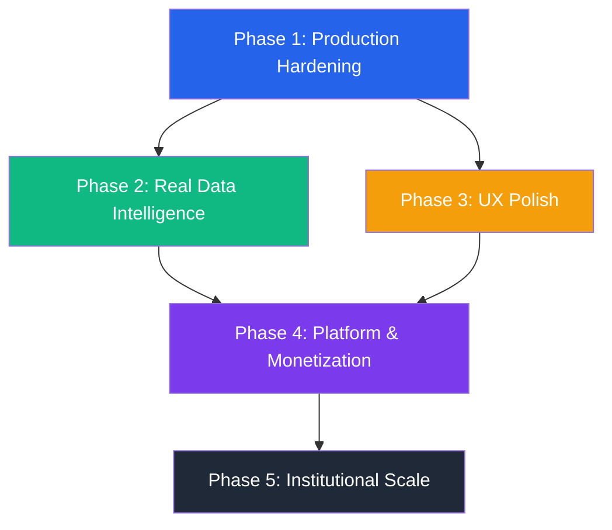

# Liquid — Institution-Grade Roadmap

> **Current state:** Stable MVP with PostgreSQL persistence, unified AppLayout, live Alerts dashboard, and modular component architecture. TypeScript clean. Dev server running.
>
> This roadmap is structured around the percentage milestones defined in `replit.md`, with the engineering specifics added for each stage.

---

## How to read this

Each phase has a **gate** — a condition that must be true before the next phase starts. Skipping gates is how platforms accumulate technical debt that kills them at scale.

> [!NOTE]
> **Design DNA (from `replit.md`):** All work must preserve the premium finance terminal aesthetic. Inter for all typography. Blue primary, green for gains, amber for urgency, red for true risk only. Rounded-2xl cards, thin borders, restrained gradients. No generic SaaS panels.

---

## Phase 1 — Launch Foundation `(0–10%)`
*Goal: A real, public URL that explains what Liquid is and lets users start a portfolio.*

> [!IMPORTANT]
> `replit.md` explicitly calls this out: **"narrative-first, not asset-first."** The homepage must do the work of trust-building before users see portfolio data. This is currently missing entirely.

### 1.0 Marketing Homepage (Missing entirely)
| Task | Detail |
|---|---|
| Dedicated `/` landing route | Separate from the `/dashboard` app shell |
| Narrative: what, who, problem, promise | Explain sell-window timing before showing data |
| 3–5 proof points | Depreciation tracking, alerts, condition-aware liquidation |
| Clear CTA | "Start tracking" → signup flow |

### 1.1 Authentication
| Task | Detail |
|---|---|
| Add auth layer | Use **Clerk** or **Auth.js** (NextAuth) — not rolling your own |
| Protect all API routes | Middleware that rejects unauthenticated requests |
| Scope data to user | Every DB query filters by `user_id` from the JWT |
| Session management | Refresh tokens, logout, device revocation |

**Why Clerk over a custom solution:** JWT signing, refresh rotation, device management, and MFA are each 2-week problems. Clerk solves all four in a day.

### 1.2 Database in Production
| Task | Detail |
|---|---|
| Provision Neon or Supabase | Managed PostgreSQL with connection pooling (PgBouncer) |
| Run `drizzle-kit push` | Sync schema to production |
| Run seed script | Populate demo user + assets |
| Add `DATABASE_URL` to hosting env | Vercel / Railway / Render secret |
| Backup policy | Automated daily snapshots (Neon does this out of the box) |

### 1.3 Deployment Pipeline
| Task | Detail |
|---|---|
| Host frontend | **Vercel** — zero-config for Vite apps |
| Host API server | **Railway** or **Render** — Node.js with env vars |
| CI/CD | GitHub Actions: `tsc --noEmit` + `drizzle-kit check` on every PR |
| Environment parity | `dev` / `staging` / `production` branches and envs |

### 1.4 Error Observability
| Task | Detail |
|---|---|
| Frontend error tracking | **Sentry** (5 min to install) |
| API error logging | **Pino** structured JSON logs → **Logtail** or **Axiom** |
| Uptime monitoring | **BetterUptime** or **UptimeRobot** — free tier |

**Gate:** ✅ A real user can sign up from the homepage, add an asset, and see it persist across page refreshes on a public URL.

---

## Phase 2 — Product-Market Clarity `(10–25%)`
*Goal: The core resale loop (add asset → monitor decay → receive alert → liquidate) works end-to-end.*

> [!NOTE]
> `replit.md` defines the beachhead: **consumer electronics and premium gear only**. Do not expand to other asset classes until the resale loop is proven here.

### 2.1 Market Price Feed
| Task | Detail |
|---|---|
| Integrate eBay Browse API | Query sold listings for `{make} {model}` to get real secondary market prices |
| Integrate BackMarket API | Refurbished pricing as a floor signal |
| Store price snapshots | New table `price_history(asset_id, source, price_cents, captured_at)` |
| Replace `currentValue` | Derive from latest price snapshot, not manual entry |

### 2.2 Release Calendar Intelligence
| Task | Detail |
|---|---|
| Scrape / subscribe to GSMArena, MacRumors | Product release dates that trigger cliff events |
| Store in `release_events` table | Already partially modeled (RELEASE_EVENTS array in home.tsx) |
| Wire to depreciation cliff | `cliff_date` = release date − 14 days (configurable per category) |
| Admin panel (basic) | Simple form to add/edit release events |

### 2.3 Python AI Service (FastAPI)
*This is the correct time to build what Prompt 4 assumed existed.*

| Task | Detail |
|---|---|
| Bootstrap FastAPI service | New workspace: `services/valuation-engine/` |
| HuggingFace sentiment model | Analyze product review sentiment → `sentiment_score` |
| Depreciation modifier | `cliff_modifier = base_drop * (1 + sentiment_weight)` |
| REST endpoint | `POST /api/v1/catalyst/analyze` → `{ cliff_modifier, confidence }` |
| Benchmark response time | If P95 < 2s → call synchronously. If > 2s → add BullMQ (Prompt 4) |

### 2.4 Liquid Score v2
| Task | Detail |
|---|---|
| Incorporate real market data | Score = f(daysAway, sentimentScore, priceVelocity) |
| Historical grade tracking | New table `score_history(user_id, score, grade, recorded_at)` |
| Trend visualization | Line chart on Rings page showing score over 30/90/180 days |

**Gate:** ✅ The depreciation cliff for "iPhone 14 Pro" updates automatically when a new eBay sold listing is crawled, without any manual input.

---

## Phase 3 — User Experience Polish
*Goal: The platform should feel like Robinhood or Revolut, not a side project.*

### 3.1 Explainability & Reporting
| Task | Detail |
|---|---|
| Exportable PDF portfolio statement | Value saved, realized gains, current at-risk |
| Transparent assumptions | Show users exactly how cliff dates and drop % are calculated |
| Per-asset history | Full liquidation timeline (exists in AssetDrawer, needs persistence) |
| Scenario planning | "Sell now vs hold vs partial exit" — AssetDrawer already has a What-if Simulator |

### 3.2 Notifications
| Task | Detail |
|---|---|
| Email alerts | **Resend** — "Your sell window for iPhone 14 Pro opens tomorrow" |
| Push notifications | Web Push via **Novu** or **OneSignal** |
| Notification preferences | Per-asset, per-urgency-level opt-in |
| Weekly digest | "Portfolio Health" summary email |

### 3.3 Real Data (moved here from Phase 2 draft)
| Task | Detail |
|---|---|
| eBay Browse API | Real sold listing prices replace manual `currentValue` entries |
| Release calendar feed | GSMArena / MacRumors → populate `release_events` table (partial UI exists) |
| Price history table | `price_history(asset_id, source, price_cents, captured_at)` |
| Python AI service | *Build after eBay data works* — FastAPI + HuggingFace sentiment → `cliff_modifier` |
| BullMQ queue | *Add only if* P95 AI response time > 3s |

**Gate:** ✅ A user can export a PDF showing how much they saved vs market price, and the depreciation assumptions are explained in plain language on-screen.
| Task | Detail |
|---|---|
| "Snap to Value" camera ingestion | Mobile browser camera → image recognition → auto-populate `make/model` |
| Suggested portfolio | After signup, show "Add your first asset" with popular categories |
| Empty state designs | Every page needs a proper empty state (not blank space) |
| Guided tour | First-run tooltips on KPIs and sell window concept |

### 3.2 Notifications
| Task | Detail |
|---|---|
| Email alerts | **Resend** (simple API) — "Your sell window for iPhone 14 Pro opens tomorrow" |
| Push notifications | Web Push API via **Novu** or **OneSignal** |
| Notification preferences | Per-asset, per-urgency-level opt-in |
| Digest emails | Weekly "Portfolio Health" report |

### 3.3 Native Mobile App
| Task | Detail |
|---|---|
| **React Native + Expo** | Shares `@workspace/api-client-react` hooks — no API rewrite |
| Camera ingestion | Native camera access for "Snap to Value" |
| Push notifications | Native push via Expo Notifications |
| Biometric auth | Face ID / fingerprint for quick access |

> [!TIP]
> Because the API client is already a standalone workspace package, the mobile app gets the full data layer for free. This is the payoff of the monorepo architecture.

**Gate:** ✅ A user receives a well-timed alert, acts on it, and the "Session Performance Card" shows verified savings vs the market price at time of sale.

---

## Phase 3 — Trust & Retention `(25–40%)`
*Goal: Users come back because Liquid proves its value, not just because it looks good.*

> [!NOTE]
> `replit.md`: *"Build reporting that proves value saved vs value lost."* The Session Performance Card and Achievement Wall already exist in the dashboard — they need to be surfaced more prominently and made exportable.

### 4.1 Tiers
| Tier | Features | Price |
|---|---|---|
| **Free** | 3 assets, basic depreciation, manual values | $0 |
| **Pro** | Unlimited assets, live market data, email alerts | $9/mo |
| **Vault** | Everything + API access, bulk import, team accounts | $29/mo |

**Implementation:** Stripe Billing + `subscription_tier` column on `users` table. Feature flags checked server-side.

### 4.2 Bulk Import & Export
| Task | Detail |
|---|---|
| CSV import | Upload receipts/inventory sheets → parse → create assets |
| Apple Receipts integration | Parse App Store / Apple receipt emails via IMAP |
| Export to PDF | "Portfolio Statement" — useful for insurance purposes |

### 4.3 Marketplace Integrations (Deep)
| Task | Detail |
|---|---|
| eBay one-click listing | "Sell on eBay" button pre-fills title, description, price floor |
| Swappa integration | Same for electronics-specific marketplace |
| Depop / Vinted | Fashion category assets |

### 4.4 Multi-user / Teams
| Task | Detail |
|---|---|
| Household portfolios | Multiple users under one account |
| Business accounts | IT asset managers tracking company hardware |
| Read-only share links | "Share your portfolio health" — viral growth loop |

**Gate:** ✅ Stripe webhook upgrades a user to Pro, the asset limit is enforced server-side, and a reseller account can manage 50+ assets without performance degradation.

---

## Phase 5 — Scale to Industry Standards `(60–100%)`
*Goal: Production-grade performance, compliance, and platform APIs.*

### 5.1 Security Hardening
| Task | Detail |
|---|---|
| Penetration test | External pen test (HackerOne, Cobalt) |
| OWASP Top 10 audit | Rate limiting, input sanitization, SQL injection checks |
| SOC 2 Type I | Document controls (access, availability, confidentiality) |
| GDPR compliance | Data export, right-to-erasure endpoint, cookie consent |

### 5.2 API Platform
| Task | Detail |
|---|---|
| Public REST API | Third-party apps can read a user's portfolio with OAuth scopes |
| Webhooks | `asset.window_opened`, `asset.cliff_reached`, `score.changed` |
| API key management | Dashboard for generating/revoking keys |
| Rate limiting | Per-key, per-tier limits via Redis |

### 5.3 White-label / B2B
| Task | Detail |
|---|---|
| Insurance integrations | Auto-populate insured value from Liquid portfolio |
| Accounting software | QuickBooks / Xero export of depreciated asset values |
| Enterprise SSO | SAML / OIDC for corporate IT teams |

**Gate:** ✅ An enterprise customer can read their company's asset portfolio via API key without any Liquid UI involvement.

---

## Dependency Map



---

## Where You Are Now

```
Phase 1 — Launch Foundation     ████████░░  80%  (missing: homepage, auth, deployment)
Phase 2 — Product-Market Clarity ██░░░░░░░░  20%  (core loop partial, market data missing)
Phase 3 — Trust & Retention     ███░░░░░░░  30%  (AssetDrawer scenarios exist, exports missing)
Phase 4 — Monetization          ░░░░░░░░░░   0%  (not started)
Phase 5 — Scale & Compliance    ░░░░░░░░░░   0%  (not started)
```

---

## Immediate Next 3 Actions (to finish Phase 1)

1. **Build the marketing homepage** — New `/` route (or dedicated `landing.tsx`) with narrative, proof points, and CTA. The current dashboard should move to `/dashboard`.
2. **Add Clerk auth** — `pnpm add @clerk/clerk-react`, wrap `main.tsx`, add Express middleware. Scope all DB queries to `user_id`.
3. **Provision Neon + Deploy** — Neon free tier → `drizzle-kit push` → seed → Vercel (frontend) + Railway (API). Those three actions make Liquid a publicly usable product.
